# 🛡️ BharatBridge — Multi-Provider Routing & Fallback Matrix

> **Capability Principle**: `Provider selection is determined strictly by verified language capabilities, latency, health status, and failure isolation.`

---

## 1. Provider Routing Chains

```mermaid
flowchart TD
    subgraph STTChain["Speech-to-Text (STT) Chain"]
        S1[Web Speech API] -->|Browser Fallback| S2[Azure Speech STT]
        S2 -->|Service Outage| S3[Local Audio Capture]
    end

    subgraph NMTChain["NMT Translation Chain"]
        T1[Gemini 2.5/2.0 Flash LLM] -->|Quota/429/Timeout| T2[Google Translate GTx]
        T2 -->|Network Failure| T3[Azure Translator API]
        T3 -->|Regional Fallback| T4[Bhashini NMT Engine]
    end

    subgraph TTSChain["Text-to-Speech (TTS) Chain"]
        V1[Smallest.ai Waves API] -->|Synthesis Outage| V2[Azure Neural TTS]
        V2 -->|Network Failure| V3[Google Universal Neural TTS]
        V3 -->|Client Fallback| V4[Browser SpeechSynthesis]
    end
```

---

## 2. Failure Isolation & Resilience Rules

1. **Decoupled Caption Delivery**:
   * If TTS synthesis fails or times out, text captions deliver to listeners immediately in **~350ms**. Caption rendering is never blocked by TTS.

2. **STT Stream Stability**:
   * If browser STT pauses during silence, the `onend` handler auto-restarts capture without breaking the active WebSocket connection.

3. **Non-Blocking Persistence**:
   * Firestore DB writes and Azure Blob Storage uploads run in async background tasks off the live stream path.

---

## 3. Provider Capability Registry Summary

| Subsystem | Primary Engine | Fallback 1 | Fallback 2 | Client Fallback |
| :--- | :--- | :--- | :--- | :--- |
| **STT Stream** | Web Speech API | Azure Speech API | Local Recording | `SpeechRecognition` |
| **NMT Translation** | Gemini 2.5 Flash | Google Translate GTx | Azure Translator API | Bhashini NMT |
| **TTS Synthesis** | Smallest.ai Waves | Azure Neural TTS | Google Universal Neural | `window.speechSynthesis` |
| **Cloud Storage** | Azure Blob Storage | Local Storage Cache | None | Local File Export |
| **Database** | Cloud Firestore | Local Cache | None | Browser LocalStorage |
